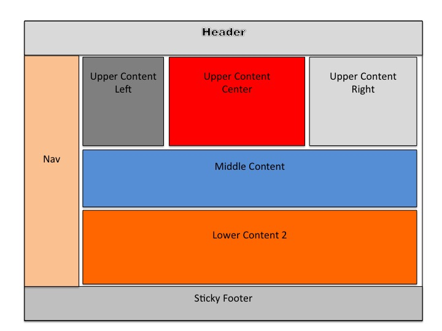

# Curso _Grid CSS_

Los códigos de mi [Curso de _Grid CSS_](https://www.youtube.com/playlist?list=PLvq-jIkSeTUY628cyd9LVbXSXi2xG9mUl): 17 videos en los que te enseño todo lo que necesitas saber sobre _Grid_, el sistema de maquetación bidimensional de _CSS_, con filas y columnas al mismo tiempo, para estructurar las secciones de tus sitios y aplicaciones _web_.

## Para comenzar

Descarga [`para_comenzar.html`](./para_comenzar.html): trae el _HTML_ de todos los ejemplos del curso, con sus estilos base pero todavía sin _Grid_. A lo largo de los videos lo vamos completando hasta llegar a `grid.html`.

## Archivos

| Archivo                  | Videos                                                                                                | Qué hay                                                                                                                                                                                                         |
| ------------------------ | ----------------------------------------------------------------------------------------------------- | --------------------------------------------------------------------------------------------------------------------------------------------------------------------------------------------------------------- |
| `para_comenzar.html`     | [1](https://www.youtube.com/watch?v=gCox2CqYvto)                                                      | El archivo base del curso.                                                                                                                                                                                      |
| `grid.html` y `grid.css` | [1](https://www.youtube.com/watch?v=gCox2CqYvto) a [15](https://www.youtube.com/watch?v=vnK7MMSXGVI)  | Un ejemplo por tema: _grid_ explícita, posicionamiento con líneas, nombres y áreas, _grid_ implícita, flujo, capas, orden, alineación, tamaños, patrones repetitivos, _grids_ dinámicas, anidadas y _subgrids_. |
| `grid_layout.html`       | [16](https://www.youtube.com/watch?v=It-jSvYDW8M)                                                     | Una maquetación _responsive_ completa con _grid lines_.                                                                                                                                                         |
| `grid_layout_areas.html` | [17](https://www.youtube.com/watch?v=g6a2zmEsTZE)                                                     | La misma maquetación con _grid areas_.                                                                                                                                                                          |
| `holy-grail-layout.jpg`  | [16](https://www.youtube.com/watch?v=It-jSvYDW8M) y [17](https://www.youtube.com/watch?v=g6a2zmEsTZE) | El boceto de la maquetación de los dos últimos videos.                                                                                                                                                          |

Esta es la maquetación que construimos al final del curso, de las dos formas:

## Recursos teóricos

- [Artículo sobre _Grid_](https://jonmircha.com/grid): mis apuntes del curso, con cada propiedad y sus ejemplos.
- [Curso de _Flexbox CSS_](../curso-flexbox): el complemento de _Grid_ para acomodar lo de adentro de cada componente.

## Mis redes

- 🦊 Visita mi web https://jonmircha.com
- 🔔 Suscríbete al canal https://youtube.com/@jonmircha
- 📬 Suscríbete a mi newsletter https://jonmircha.com/newsletter
- 🌮 ¿Me invitas un taco? https://jonmircha.com/taco
